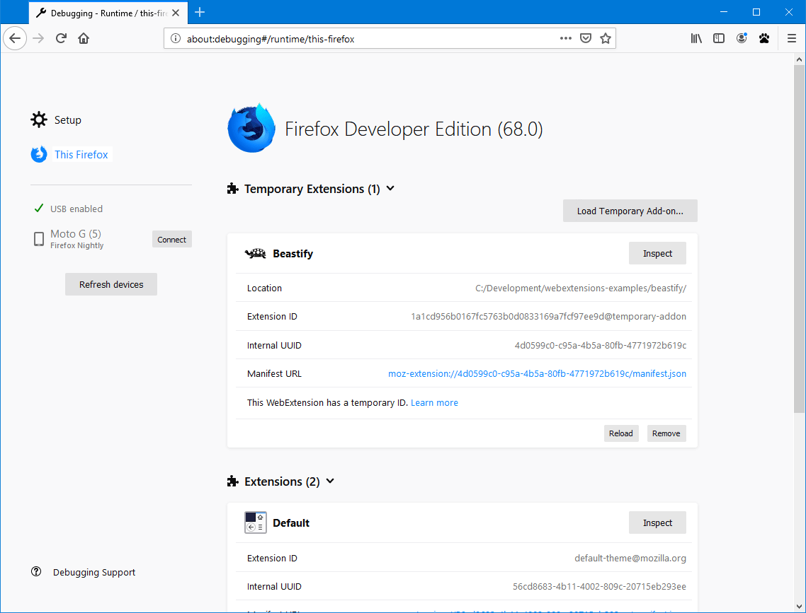
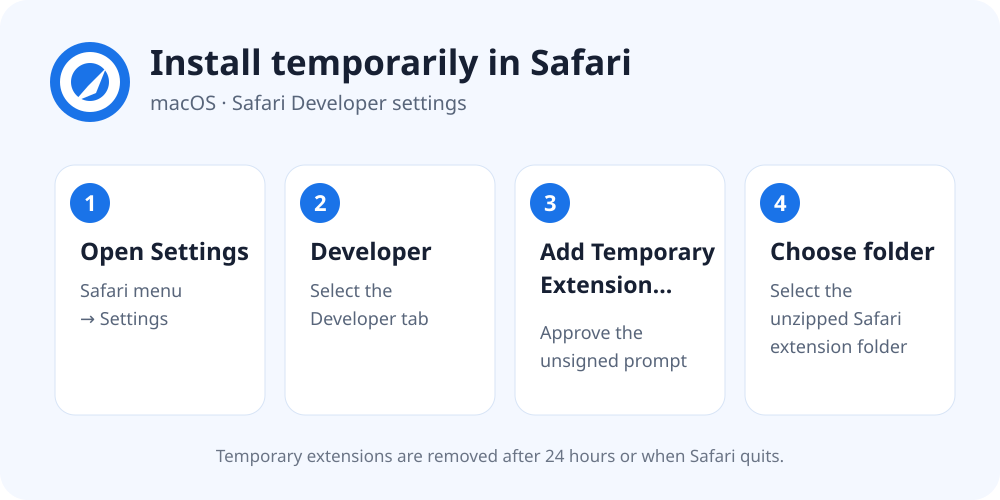

# Install Google Goto Url Fix

Until the browser-store listings are approved, use the instructions below. Only
install extensions downloaded from this project's official GitHub Releases page.

## Chrome

1. Download `google-goto-url-fix-chrome-<version>.zip` from the latest GitHub Release.
2. Unzip it into a permanent folder. Do not delete that folder after installation.
3. Open `chrome://extensions`.
4. Enable **Developer mode** in the upper-right corner.
5. Click **Load unpacked** and select the unzipped folder.
6. Pin **Google Goto Url Fix** from Chrome's Extensions menu if desired.


_Chrome interface screenshot from [Chrome for Developers](https://developer.chrome.com/docs/extensions/get-started/tutorial/hello-world), licensed under CC BY 4.0._

Chrome may periodically display a developer-mode warning. Updates are manual:
download the new release, replace the files in the same folder, then click the
extension's **Reload** button on `chrome://extensions`.

## Microsoft Edge

1. Download `google-goto-url-fix-edge-<version>.zip` from the latest GitHub Release.
2. Unzip it into a permanent folder.
3. Open `edge://extensions`.
4. Enable **Developer mode**.
5. Click **Load unpacked** and select the unzipped folder.

Edge's Extensions page uses the same Developer mode and **Load unpacked** flow
shown in the Chrome screenshot above.

Updates are manual until the Microsoft Edge Add-ons listing is available.

## Firefox

For normal persistent installation:

1. Download `google-goto-url-fix-firefox-<version>.xpi` from the latest GitHub Release.
2. Open `about:addons`, click the gear menu, and choose **Install Add-on From File…**.
3. Select the downloaded XPI and approve the requested permissions.

The XPI is signed by Mozilla for self-distribution. It does not require a public
Firefox Add-ons listing. For temporary testing of an unsigned source build:

1. Download and unzip `google-goto-url-fix-firefox-<version>.zip`.
2. Open `about:debugging#/runtime/this-firefox`.
3. Click **Load Temporary Add-on**.
4. Select `manifest.json` inside the unzipped folder.



_Firefox interface screenshot from [Mozilla Firefox Source Docs](https://firefox-source-docs.mozilla.org/devtools-user/about_colon_debugging/). The exact styling may vary by Firefox version._

Firefox removes temporary add-ons when it restarts. Updates to a self-distributed
XPI are manual unless an HTTPS update manifest is added later.

## Safari on macOS

For normal installation outside the Mac App Store:

1. Download `google-goto-url-fix-safari-app-<version>.zip` from the latest GitHub Release.
2. Unzip it and move **Google Goto Url Fix.app** to the Applications folder.
3. Open the app once, then open Safari → Settings → Extensions.
4. Enable **Google Goto Url Fix** and approve access to Google when prompted.

Yes, the Safari download must be unzipped first: Safari installs the macOS `.app`
inside the archive, not the ZIP itself. Do not use **Add Temporary Extension** for
the `safari-app` release.

The app and embedded Safari extension are signed with Apple Developer ID,
notarized by Apple, and distributed directly. Updates are manual: replace the app
in Applications with the newer release.

For temporary testing of an unsigned source build, Safari 18.4 or later can load
a web-extension folder:

1. Download and unzip `google-goto-url-fix-safari-<version>.zip`.
2. In Safari, enable developer features if the **Developer** settings tab is hidden.
3. Open Safari → Settings → Developer.
4. Click **Add Temporary Extension…** and select the unzipped folder.
5. Approve the unsigned-extension prompt and enable the extension.



_Diagram based on Apple's current [Running your Safari web extension](https://developer.apple.com/documentation/safariservices/running-your-safari-web-extension) instructions._

Safari removes temporary extensions after 24 hours or when Safari quits.

## Use

1. Open an unauthenticated Google Search results page containing `/goto` links.
2. Click the extension's toolbar button.
3. A blue **ON** badge means Google redirect links are being replaced with their
   ordinary destination URLs.
4. Click again to turn it off and restore the original links.

The extension runs on supported Google Search country domains, stores its preferences,
temporary pause time, and latest lookup error locally, and has no analytics or
developer-operated service. Nearby prefetch can be disabled in extension options.

## Build from source

Node.js 20 or newer is required. The build has no package-manager dependencies and
writes standard ZIP archives directly, so Java and platform-specific ZIP tools are
not required.

```sh
npm run check
npm run test:browser  # optional; requires agent-browser
```

Generated browser directories and release ZIPs are written to `dist/`.
